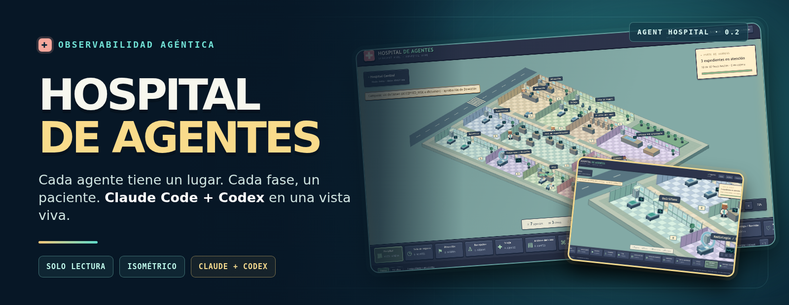
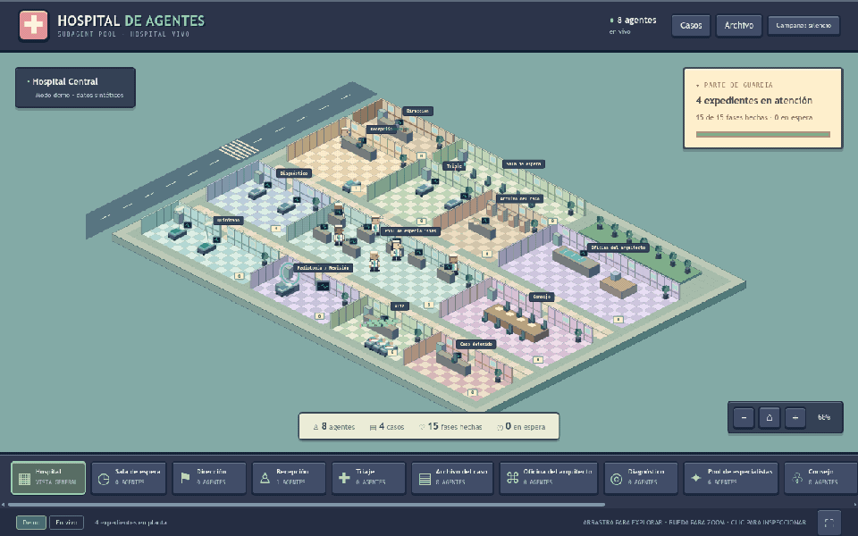
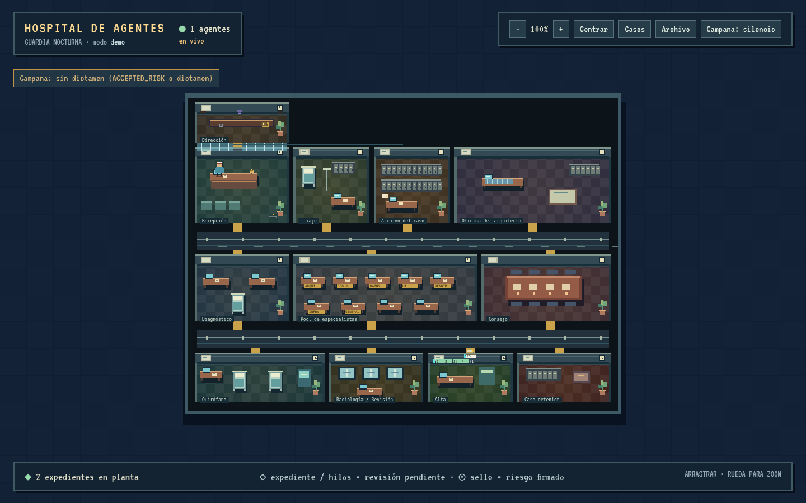
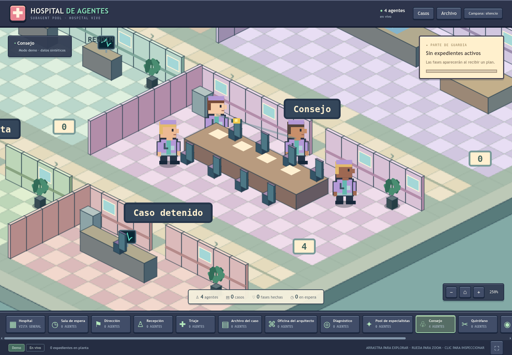
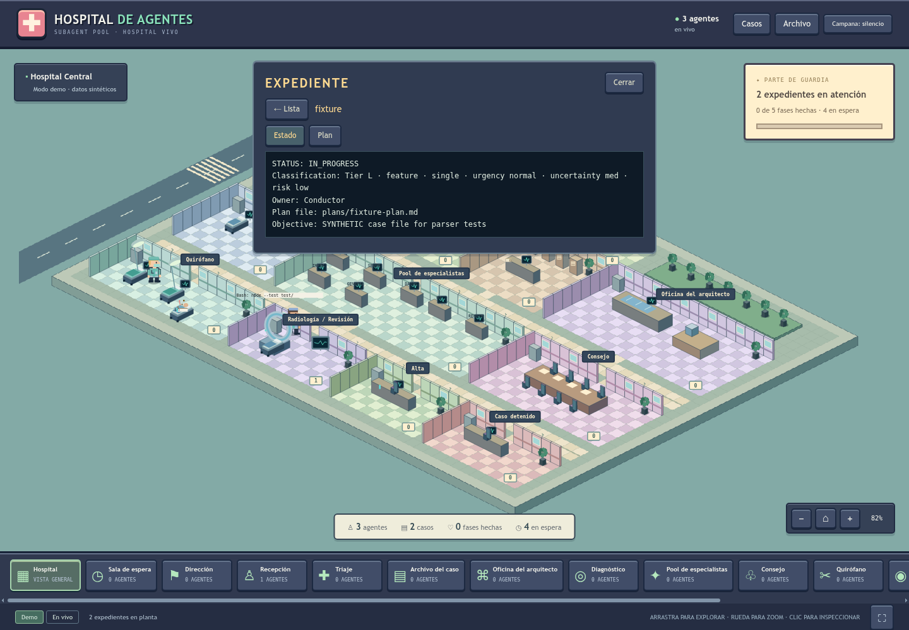

# 🏥 Hospital de agentes



[](LICENSE)
[](https://docs.docker.com/compose/)
[](https://nodejs.org/)

Pixel-art, read-only viewer that shows the agents of [subagent-pool](#hecho-con-subagent-pool) (Claude Code) working live, from local transcripts, in Docker.
Unofficial and independent: not an Anthropic or OpenAI project.



*Modo demo · datos sintéticos*

**Una vista cenital en píxeles de los agentes de [subagent-pool](#hecho-con-subagent-pool).** Cada agente es un
personaje, cada expediente una camilla y cada fase del plan un paciente. Node.js 22 sin dependencias, en Docker,
solo lectura.

```
subagent-pool (Conductor, planning, implement, review, consejo…)
        │ escribe transcripciones .jsonl
        ▼
~/.claude/projects/  ──(montaje :ro)──►  servidor Node 22: tail → normalizar → reducir
expedientes plans/*-state.md ──(:ro)──►        │  SSE /events
                                               ▼
                                 navegador: Canvas 2D, una sala por rol
```

---

## Qué es y qué no

Es un **visor**. Lee lo que los agentes ya dejan en disco y lo dibuja; no ejecuta agentes, no escribe en el
proyecto y no decide nada por ellos. No es un panel de control: no pausa, no aprueba y no reintenta. Tampoco
es un sustituto de los logs: solo muestra fases, avisos y mensajes resumidos.

## Capturas

Capturas en modo demo, con datos sintéticos (`docs/screenshots/`):

| Vista general | Zoom al Consejo (`?freezeScene=council`) | Archivo del caso (expediente de prueba) |
|---|---|---|
|  |  |  |

## Cómo se mapea subagent-pool a las salas

| En subagent-pool | Sala | Qué se ve |
|---|---|---|
| Conductor | Recepción | Recibe el encargo; la campana de escalado está en su mostrador |
| planning-agent | Diagnóstico | Redacta el plan: cada fase del plan es un paciente |
| implement-agent | Quirófano | Implementa la fase en curso |
| review-agent | Radiología / Revisión | Revisa; los avisos (warnings) bloquean la salida del paciente |
| review-agent en modo consulta | Pool de especialistas | Consulta puntual; nunca mueve el expediente |
| council-spec, -architect, -lateral, -risk | Consejo | Cuatro sillas para el debate |
| AgentArchitect | Oficina del arquitecto | Diseña equipos |
| Expediente (`plans/*-state.md`) | Triaje → Archivo del caso | Nivel S/M/L, progreso y expediente legible |
| Decisión pendiente del usuario | Dirección | Entrega y aprobaciones |
| Fase cerrada y aprobada | Alta | Pacientes dados de alta |
| Caso bloqueado o sin evidencia | Caso detenido | Expediente parado |

Las cápsulas que viajan por los tubos neumáticos son los `SendMessage` entre agentes. Los agentes que terminan salen del mapa tras unos segundos.

## Puesta en marcha

```bash
docker compose up -d --build          # demo: http://127.0.0.1:8700 (no monta nada del disco)
curl http://127.0.0.1:8700/api/health # {"ok":true,"mode":"demo"}
docker compose -f docker-compose.yml -f compose.live.yml up -d --build   # live: lee transcripciones y expedientes (solo lectura)
docker build --target test .          # pruebas unitarias dentro de Docker
```

> **Advertencia:** `docker run -p 8700:8700 …` publica el puerto en **todas las interfaces** de la máquina y el
> visor **no tiene autenticación**. Usa `docker compose`, que publica solo `127.0.0.1:8700`.

Sin Docker, con Node 22: `npm start` y `npm test`.

**Demo o live**

- **Demo** (por defecto, `docker-compose.yml`): escena sintética y determinista (`src/demo.js`). No monta ni lee nada
  del disco. Es la forma segura de ver la interfaz.
- **Live** (`docker-compose.yml` + `compose.live.yml`): lee las transcripciones montadas en `/data/projects` y los
  expedientes de `HOSPITAL_CASE_DIRS`, con montajes `:ro`. El override fija `HOSPITAL_MODE=live`. Requisitos: que existan
  `~/.claude/projects`, `~/Documentos/Docker` y `~/Documentos/IA` (si no existen, Docker los crea como root) y que los
  archivos sean legibles por el UID 1000 del contenedor. Para otras rutas, cambia `HOSPITAL_CASE_DIRS` y los montajes de
  `compose.live.yml` a la vez. En live aparece un selector de sesiones.
- `HOSPITAL_MODE=live docker compose up -d` ya no activa live: sin el override no hay montajes y la vista queda vacía.

Parámetros de consulta (solo para pruebas y capturas; no envían nada al servidor):

| Parámetro | Efecto |
|---|---|
| `mode=demo\|live` | Modo de la página |
| `session=<id>` | Sesión concreta (solo `live`) |
| `freeze=<Herramienta>` | Congela el reloj y muestra el equipo de esa herramienta |
| `freezeWarn=<fixed\|must_fix\|acceptable\|held>` | Un expediente fijo en ese estado de aviso |
| `freezeScene=<waiting\|consult\|council\|tube\|accepted\|direction\|direction-answered>` | Escena fija con zoom ≥ 300 % |

## Variables de entorno

| Variable | Por defecto | Uso |
|---|---|---|
| `HOSPITAL_MODE` | `demo` | Modo por defecto (`demo` o `live`) |
| `HOSPITAL_WINDOW_H` | `6` | Horas de transcripción que se leen al arrancar |
| `HOSPITAL_CASE_DIRS` | `$HOME/Documentos/Docker` y `$HOME/Documentos/IA` (en `compose.live.yml`) | Raíces absolutas separadas por `:`; de cada una se leen los `plans/*-state.md`. Cada raíz debe tener su montaje `:ro` en `compose.live.yml` |
| `HOSPITAL_CONDUCTOR_IDLE_MIN` | `30` | Minutos sin eventos tras los que un Conductor inactivo sale del mapa. Un valor no válido (no entero ≥ 1) usa 30 y deja un aviso en el log |
| `HOSPITAL_ALLOWED_HOSTS` | vacío | Nombres de host adicionales aceptados en la cabecera `Host`, separados por comas, sin puerto ni esquema. Ejemplo: `HOSPITAL_ALLOWED_HOSTS=192.0.2.10,box.lan` |
| `PORT` / `HOST` | `8700` / `0.0.0.0` | Escucha dentro del contenedor (el compose publica solo `127.0.0.1:8700`) |

## Seguridad y privacidad

- **Solo lectura.** En live, las transcripciones y los expedientes se montan con `:ro` (`compose.live.yml`); en demo no se
  monta nada. La aplicación no escribe en ningún volumen.
- **Permisos.** El contenedor corre como UID 1000: en live, los archivos montados deben ser legibles por ese usuario.
- **Publicación local.** `docker-compose.yml` publica el puerto solo en `127.0.0.1`. No hay autenticación: no lo expongas
  a una red sin una decisión explícita (cambiar la publicación y revisar `HOSPITAL_ALLOWED_HOSTS`).
- **Guardia de Host y Origin.** Solo se aceptan `localhost`, `127.0.0.1` y `[::1]` (cualquier puerto) más los hosts de
  `HOSPITAL_ALLOWED_HOSTS`. Otro `Host` recibe `421`; una petición a `/api/*` desde otro sitio recibe `403`.
- **Confinamiento.** Una transcripción solo se sigue si su ruta real (con symlinks resueltos) cae dentro de una raíz
  montada. El archivo de expedientes usa ids opacos (un hash, sin rutas) y tipos fijos (`state`, `plan`, `council-*`,
  `shot-*`); el cliente nunca envía una ruta. Los symlinks que salen de `plans/` se rechazan.
- **Redacción best effort.** Antes de mostrar un texto se tapan claves con formato reconocible (`sk-`, `ghp_`, `xox*`,
  `AKIA…`, `Bearer`, JWT, bloques de clave privada y asignaciones `password|secret|token|api_key = valor`). El visor
  muestra cuántos secretos tapó. **No es una garantía**: un secreto con otro formato, o cualquier dato dentro de una
  captura, se muestra tal cual. Los SHA y otros hashes no se tapan a propósito.
- **Fuente externa.** La página pide la fuente VT323 a Google Fonts (`fonts.googleapis.com`). El navegador de quien
  mire el visor hace esa petición (la IP y el user-agent llegan a Google). Si no carga, se usa una monoespaciada del
  sistema. Para evitarlo, quita esa línea de `public/index.html` (la misma petición está en
  `design/codex-astra/index.html`, la referencia visual).
- Vulnerabilidades: ver [`SECURITY.md`](SECURITY.md).

## Endpoints

| Ruta | Qué devuelve |
|---|---|
| `GET /api/health` | Estado y modo |
| `GET /api/state?mode=&session=` | Foto del estado: agentes, expedientes, fases, mensajes |
| `GET /api/sessions` | Sesiones disponibles (solo `live`) |
| `GET /events?mode=&session=` | Flujo SSE de eventos y estado |
| `GET /api/archive` | Expedientes del archivo (ids opacos, sin rutas) |
| `GET /api/doc?case=<id>&doc=<tipo>` | Un documento de un expediente (texto o PNG); solo lectura |

El archivo se abre con el botón «Archivo», con la sala «Archivo del caso» o con el botón del expediente en el inspector.
Muestra las pestañas Estado, Plan, Decisiones/Debate/Brief de cada consejo y Capturas (`plans/shots/*.png`). Los
textos se muestran como texto plano, cortados a 256 KB.

## Pruebas

```bash
npm test                          # node --test test/*.test.js (321 pruebas)
docker build --target test .      # las mismas pruebas dentro de Docker
```

Sin dependencias de desarrollo: solo la biblioteca estándar de Node 22.

## Limitaciones y problemas conocidos

- **Fase 5c planificada, no construida.** Incluye la columna de actividad con niveles, el consejo en dos pasos en los
  escritorios del pool y el bind de WireGuard en un archivo de override. Las decisiones están en `docs/design/council/hospital-5c/`.
- **Falso positivo de redacción.** La regla `api_key = valor` también tapa marcadores de posición como `api_key = value`.
  La corrección está prevista en 5c.
- **Dependencia de un formato no documentado.** Las transcripciones de `~/.claude/projects` son el formato interno de
  Claude Code. Si cambia, el modo live deja de reconocer agentes; el modo demo no se ve afectado.
- **Plural y etiquetas.** La cabecera dice «1 agentes» con un solo agente y muestra «en vivo» también en demo (es el
  estado de la conexión SSE, no de los datos).
- **Solo probado en Linux.** En macOS y Windows (Docker Desktop) no se ha verificado el montaje de `${HOME}`.
- **Acceso desde el móvil.** Requiere cambiar la publicación del puerto y `HOSPITAL_ALLOWED_HOSTS`; no hay login.

## Hecho con subagent-pool

Hospital de agentes se diseñó con [subagent-pool](https://github.com/elisaul77/Orquestacion_Agentes_claude): planificación,
consejo de cuatro miembros para las decisiones abiertas e implementación por fases con revisión. Los resultados de esos
consejos y el plan están en [`docs/design/`](docs/design/) como ejemplo real de salida de planificación.

## Fundamento: medicina → orquestación agéntica

El flujo de subagent-pool (triaje, diagnóstico con falsador, consulta frente a consejo, expediente y alta) toma su
estructura de la medicina hospitalaria. Estado del arte y fuentes, en [`docs/estado-del-arte.md`](docs/estado-del-arte.md)
(revisión preliminar, no es un paper). Diseños de referencia: [caso (case-flow)](https://github.com/elisaul77/Orquestacion_Agentes_claude/blob/master/docs/proposals/case-flow.md)
y [flujo v9.12](https://github.com/elisaul77/Orquestacion_Agentes_claude/blob/master/docs/proposals/flujo-v9-12.html).
Trabajos externos: [MOLT Sinai (Cockroach Labs)](https://www.cockroachlabs.com/blog/experiment-running-hospital-code/) y
[MDAgents (NeurIPS 2024)](https://proceedings.neurips.cc/paper_files/paper/2024/file/90d1fc07f46e31387978b88e7e057a31-Paper-Conference.pdf).

## Documentación

- [`docs/estado-del-arte.md`](docs/estado-del-arte.md): medicina → orquestación agéntica (revisión preliminar).
- [`CHANGELOG.md`](CHANGELOG.md): historial de versiones.
- [`docs/design/`](docs/design/): plan y decisiones de los consejos (4b, 5b1, 5c). Rutas personales sustituidas por marcadores.
- [`design/codex-astra/`](design/codex-astra/): propuesta visual de referencia (rediseño de Codex), con su propio README.

## Créditos

- Conceptos inspirados en [pablodelucca/pixel-agents](https://github.com/pablodelucca/pixel-agents),
  [YehudaLevi/pixelagents](https://github.com/YehudaLevi/pixelagents) e [IvanWng97/pixtuoid](https://github.com/IvanWng97/pixtuoid).
  Solo los conceptos; no se copió código de esos proyectos.
- Rediseño visual con Codex (OpenAI), en `design/codex-astra/`.

## Licencia

[MIT](LICENSE).
